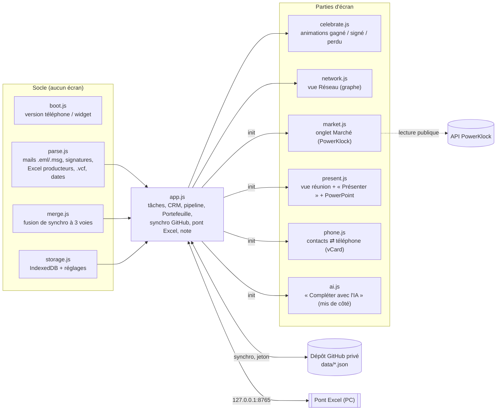

# ToDo — tâches et CRM d'agrégation

Application web (PWA) sans serveur : HTML, CSS et JavaScript, sans étape de build.

- **Code** : ce dépôt (public). Aucune donnée ni aucun secret ici.
- **Données** : dans le navigateur (IndexedDB), synchronisées dans un **dépôt GitHub privé** séparé (`data/tasks.json`, `crm.json`, `notes.json`, `parc.json`, `tasks-inbox.json`, `contacts-inbox.json`). Chaque synchro est un commit : toutes les versions passées restent dans l'historique de ce dépôt.
- **Hébergement** : Cloudflare Pages (adresse propre à l'appli, règles de sécurité de `_headers`), et GitHub Pages en secours.

## Contenu

| Fichier | Rôle |
|---|---|
| `index.html`, `app.css`, `js/` | L'appli : voir [Architecture](#architecture) |
| `vendor/` | Lecteur Excel SheetJS 0.20.3, gardé avec l'appli (marche hors ligne) |
| `sw.js` | Hors ligne : le code d'abord par le réseau, le cache en secours ; les données GitHub ne sont jamais mises en cache |
| `_headers` | Règles de sécurité de la page (Cloudflare Pages) |
| `bridge/` | Pont Excel local (PowerShell) : lit et écrit le Pipe et le Suivi sur le PC |
| `outlook-vba/` | Copie de secours de la macro Outlook (sans jeton) |
| `tests/` | Tests de bout en bout (Playwright), lancés à chaque push par GitHub Actions |

## Architecture

Les fichiers de `js/` sont chargés dans cet ordre par `index.html`. Chacun, sauf `js/app.js`, est un module autonome rangé sous un nom de `window` (`window.TodoParse`…).



| Fichier | Lignes | Rôle |
|---|---:|---|
| `js/boot.js` | ~10 | Lit `?lite` / `?widget` avant tout le reste |
| `js/storage.js` | ~115 | Données dans IndexedDB (copie en mémoire), petits réglages dans localStorage |
| `js/merge.js` | ~100 | Fusion de synchro : fiche par fiche, champ par champ ; note ligne par ligne |
| `js/parse.js` | ~900 | Lecteurs sans écran, testés seuls : demandes de prix, signatures, mails, Excel des producteurs, `.vcf`, dates françaises |
| `js/market.js` | ~185 | Onglet Marché : tableau PowerKlock, chiffres pour les mails et le mode appel |
| `js/present.js` | ~240 | Vue réunion du pipeline, présentation façon cabinet, export PowerPoint |
| `js/phone.js` | ~135 | Import des contacts du téléphone, carte de visite, export vCard sans doublons |
| `js/ai.js` | ~85 | « Compléter avec l'IA », caché tant que `feat-ai` ≠ 1 |
| `js/network.js`, `js/celebrate.js` | ~250 chacun | Graphe Réseau ; animations |
| `js/app.js` | ~7 950 | Le reste : écrans, état partagé (tâches, contacts, pipeline), synchro (`makeSyncFile` : un seul code pour tâches, CRM et note), pont Excel |

**Règles du code**
- Un module reçoit ce qu'il utilise de `app.js` une seule fois, à la fin du chargement (`init`). Il ne lit jamais une variable de `app.js` directement, sauf par un accesseur (`get contacts()`) quand `app.js` peut la remplacer.
- Ce que d'autres fichiers, les tests ou la console appellent dans `app.js` est rassemblé en un seul `Object.assign(window, {…})`, en fin de fichier.
- Pas de fenêtre du navigateur (`confirm`, `alert`, `prompt`) : la fenêtre de l'appli (`askConfirm`, `askText`, `tell`).
- Réglages de l'appareil via `lsGet` / `lsSet` : jamais d'erreur si le navigateur refuse son stockage.
- ESLint en CI : le nombre d'avertissements ne peut que baisser (`--max-warnings` dans `.github/workflows/tests.yml`).

## Réinstaller de zéro (≈ 30 min)

1. **Dépôt de données** : créer un dépôt GitHub **privé**, avec un fichier `data/tasks-inbox.json` et un fichier `data/contacts-inbox.json`, contenant chacun `[]`.
2. **Jeton** : github.com › Settings › Developer settings › Fine-grained tokens. Limiter le jeton à **ce seul dépôt**, droit *Contents : Read and write*, 90 jours.
3. **Hébergement Cloudflare Pages** : dash.cloudflare.com › Workers & Pages › Create › Pages › Connect to Git › ce dépôt. Nom du projet `todo-tom`, sans commande de build, dossier de sortie `/`. L'adresse devient `https://todo-tom.pages.dev`. Chaque push republie l'appli.
4. **Écran de connexion (option)** : Cloudflare Zero Trust › Access › Applications › Self-hosted › `todo-tom.pages.dev`. Règle : ton adresse mail (code à usage unique).
5. **Dans l'appli** : Réf. & data › Synchro. Renseigner le propriétaire, le dépôt de données et le jeton, avec sa date d'expiration. Les données reviennent depuis GitHub.
6. **Pont Excel** (PC Windows, Excel installé) : lancer `bridge/Lancer-pont-excel.bat`, choisir le Pipe et le Suivi, puis recopier la clé affichée dans Réf. & data › Pont Excel. Pour une autre adresse de l'appli, l'ajouter dans `pont-excel-config.json` : `"origins": ["https://…"]`.
7. **Macro Outlook** (option) : drapeau → tâche dans « Boîte mail », catégorie « CRM Contact » → contact. Copie de secours dans `outlook-vba/` (sans jeton ; installation dans son README). Le jeton se colle seulement dans la copie installée sur le PC, jamais ici.
8. **Téléphone** : ouvrir `…/mobile.html`, puis « Sur l'écran d'accueil ».

## Restaurer des données

- **Sur un autre appareil synchronisé** : les données y sont déjà, la synchro les remet partout.
- **Une version passée** : dans le dépôt de données, prendre l'historique de `data/*.json` et récupérer le fichier au bon commit.
- **Un export** : Réf. & data › Exporter / Importer (fichier `todo-backup-AAAA-MM-JJ.json`). Le rappel de sauvegarde revient chaque semaine.

## Tests

```
pip install playwright openpyxl && python -m playwright install chromium
python tests/smoke_test.py        # l'appli, de bout en bout
python tests/csp_test.py          # l'appli sous les règles de sécurité de _headers
python tests/mail_accuracy.py --all --min 0.95
python tests/extraction_accuracy.py --all --min 0.95
python tests/bridge_test.py       # le pont (PowerShell requis)
```
